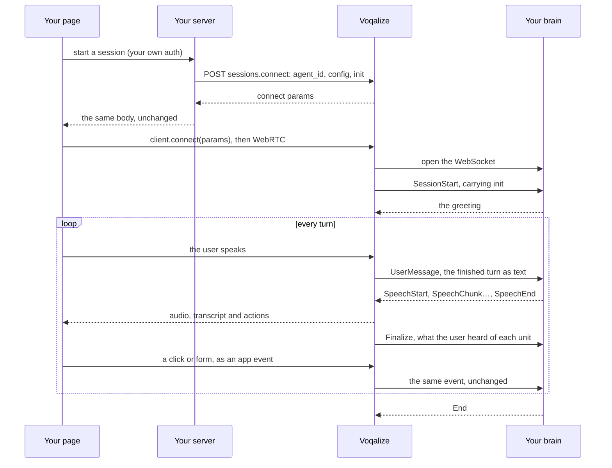

An integration has four parts. You own three of them, and you create one record
that joins them:

| Part | What it is | Who runs it |
|---|---|---|
| **Your page** | Your client on `@voqalize/client-transport`. It asks your server for a session and connects to it. | You |
| **Your server** | One HTTP request, `sessions.connect`, that decides who may start a session and with what. | You |
| **Your brain** | One WebSocket endpoint. It receives each finished user turn as text and returns speech and [actions](#glossary). | You |
| **Voqalize** | WebRTC, recognition, synthesis, turn-taking, interruption, the avatar and recording. | Voqalize |
| **The agent** | A record that says how Voqalize reaches your brain, and whether its sessions record by default. | You create it; Voqalize stores it |

Your page and your brain never talk to each other directly. Everything between
them crosses Voqalize, and none of it is audio on your side: your brain sees
text in and text out.

## What happens in a session

A **session** is one conversation, from connect to hang-up. It has one
WebSocket to your brain, opened when it starts and closed when it ends.

1. **Your page asks your server.** How that request is authenticated is yours: a
   session cookie, a bearer token, whatever your app already does. A public page
   can skip this hop and call Voqalize with a publishable `pk_` key instead.
2. **Your server calls `sessions.connect`** with the agent's secret `sk_` key. The
   body names the agent and may carry `config` (how this session sounds and
   listens, and whether it records) and `init` (anything your brain should know
   about this user). [Connect your app](/build/connect/) has the request.
3. **Your page connects.** It hands the response, unchanged, to
   `client.connect`. Media then flows directly between the browser and the
   Voqalize machine running the session.
4. **Voqalize dials your brain** at `{brain_url}?session_id={session_id}` and sends
   `SessionStart` with `init`. Your `on_session_start` runs, then `greet` returns
   the first line. The greeting is a fixed string or a template over `init`,
   because the user is already listening and a model call here is silence.
5. **The user speaks.** Voqalize decides when the turn is finished and sends it to
   your brain as `UserMessage` text. With acknowledgements on (the default),
   Voqalize says a short line such as "Sure." while your brain works.
6. **Your brain answers in speech units.** It yields `SpeechStart`, one or more
   `SpeechChunk`s and `SpeechEnd`. Speaking starts on the first chunk, so the reply
   plays while it is still being generated. During a turn it can also dispatch
   actions to the page, call tools, or change the voice and language with
   `session.configure(...)`.
7. **The user may interrupt.** Voqalize stops the audio and sends `Interruption`.
   For every unit, `Finalize` says what the user actually heard. Keep that in your
   history, not what you generated: [Transcripts and heard truth](/build/brain/transcripts/)
   explains how.
8. **The page talks back.** A click or a form submitted in your page reaches the
   brain as an app event at `on_rtvi`. It does not take a turn, so the agent
   never talks over a user who just clicked.
9. **The session ends** when the user hangs up, the brain calls `session.end()`,
   or the session reaches the one-hour cap. The session record,
   events, logs and any recording are then readable by `session_id`;
   [Reading a call back](/operate/reading-a-call/) shows how.

[The wire](/reference/wire/) specifies every frame. In Python you never build
them: you subclass `Brain` and implement callbacks, as
[Build the brain](/build/brain/) shows.

## How Voqalize reaches your brain

The agent record says how, in one of two ways, and the brain code is the same
for both. In **inbound** mode the record holds a `brain_url`, a `wss://` route in
your app that Voqalize dials once per session; this is the production default.
In **Cortex** mode your brain dials out to the Cortex relay with the agent's
`sk_` key and Voqalize meets it there, so nothing has to accept an inbound
connection. Cortex is the local-development default (no tunnel) and fits
serverless functions and egress-only networks. An agent with neither refuses
every session with `409 agent_not_configured`.
[Deploy the brain](/build/hosting/) sets up both.

## Where each setting comes from

The agent record holds no voice, language or turn-taking settings, because the
right language usually depends on the user, who does not exist until the
session starts. Each layer below overrides the one before it:

1. **Voqalize's defaults:** English on both legs, acknowledgements on, no idle
   timeout.
2. **The session creator's `config`** at `sessions.connect`: your server with an
   `sk_`, or a page with a `pk_`. Use it when your server already knows the
   user's language.
3. **The brain**, with `await session.configure(Config(...))`, from
   `on_session_start` (in time for the greeting) or at any point during the
   session.

Recording is the exception: it is the agent's default unless `config.record`
overrides it at connect, and it cannot change mid-session.
[Voice and language](/build/voice-and-language/) covers voice, language,
patience, idle and acknowledgements; [Recordings](/operate/recordings/) covers
recording and consent.

## What you can add

None of these is needed for a first session, and each is a change to one side:

| Capability | What changes | Page |
|---|---|---|
| Voice, language and turn-taking | The connect `config` or the brain | [Voice and language](/build/voice-and-language/) |
| Screen actions | The brain dispatches, the page renders | [Actions](/build/brain/actions/) |
| Stage | A spec, the brain and the page | [Stage](/build/stage/) |
| The avatar | The page only | [The avatar](/build/avatar/) |
| Camera and screen recording | The page turns lanes on | [Camera and screen](/build/video/) |
| Recording | The agent default or the connect `config` | [Recordings](/operate/recordings/) |

## Glossary

| Term | Meaning |
|---|---|
| **Brain** | Your code: one WebSocket endpoint that receives user turns as text and returns speech and actions. In Python, a `Brain` subclass. [Build the brain](/build/brain/). |
| **Agent** | The Voqalize record that names how to reach a brain (`mode` and `brain_url`) and its recording default. Configuration, not intelligence. Your own "agent" is the brain. |
| **Tenant** | The account that owns your agents, keys, sessions and members. |
| **Session** | One conversation: one connect, one WebSocket to the brain, one record. It lasts at most one hour. |
| **Turn** | One finished utterance from the user, delivered as `UserMessage` text, and the brain's reply to it. |
| **Speech unit** | One `SpeechStart` … `SpeechEnd` span of the brain's reply. Speaking starts on its first chunk, and it is the piece a user can be interrupted out of. [Speaking](/build/brain/speaking/). |
| **Heard text** | What the user actually heard of a unit, delivered in `Finalize`. Shorter than what you generated when the user interrupted. [Transcripts and heard truth](/build/brain/transcripts/). |
| **Acknowledgement (ack)** | The short line Voqalize says while your brain works on a reply. On by default. [Voice and language](/build/voice-and-language/). |
| **Action** | A typed message from the brain to the page (`session.dispatch(...)`), delivered as an RTVI `ui-command`. It renders and is never spoken. [Actions](/build/brain/actions/). |
| **App event** | A typed message from the page to the brain (`AppEvent`), arriving at `on_rtvi`. It informs the brain and does not take a turn. [Context and history](/build/brain/context/). |
| **Tool** | A function your model calls during a turn. It runs in your process. [Tools](/build/brain/tools/). |
| **The wire** | The published protobuf frames on the brain's WebSocket. Any language can implement it. [The wire](/reference/wire/). |
| **RTVI** | The message format your page and your brain share over the session's data channel. Voqalize carries it between them. [RTVI messages](/reference/rtvi/). |
| **Inbound route** | A `wss://` route in your app that Voqalize dials once per session. [Deploy the brain](/build/hosting/). |
| **Cortex** | The relay for a brain that cannot accept inbound connections: your brain dials out to it and Voqalize meets it there. [Deploy the brain](/build/hosting/). |
| **`sk_` key** | A secret key for one agent. Your server uses it for `sessions.connect`, and a Cortex brain uses it to dial the relay. [Keys](/build/keys/). |
| **`pk_` key** | A publishable key for one agent, locked to a list of browser origins. A browser page may start sessions with it. [Keys](/build/keys/). |
| **Session token** | The short-lived credential in the connect response. The browser presents it to the Voqalize machine running the session. |
| **Brain-connection token** | The short-lived credential Voqalize presents when it dials your brain. The SDK verifies it for you. [Deploy the brain](/build/hosting/). |
| **`config`** | How a session sounds and listens: `tts`, `stt`, `idle`, `ack`, and `record` at connect. Set at connect and by the brain. |
| **`init`** | Your data for the brain, passed at connect and read as `session.init`. Stored on the session, so send identifiers rather than personal data. [Context and history](/build/brain/context/). |
| **Stage** | The framework for an agent that shows and does things on the page while it talks, declared as moves in a spec. [Stage](/build/stage/). |
| **The avatar** | An animated character drawn in the page, lip-synced to the agent and driven by the session's own messages. [The avatar](/build/avatar/). |
| **Recording** | The session's audio, plus camera and screen when the page turns them on. [Recordings](/operate/recordings/). |
| **Conformance harness** | The SDK's test driver: your brain over the real wire, with no microphone and no model. [Test the brain](/build/testing/). |
| **MCP server** | The hosted tool server your coding agent uses to create agents, mint keys and read sessions. [Work with a coding agent](/build/coding-agent/). |

## Read next

- [Quickstart](/build/quickstart/): hear an agent you wrote.
- [Build an agent](/build/): every step, in order.
- [Examples](/overview/examples/): complete apps that use each part.
